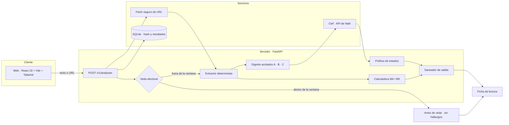
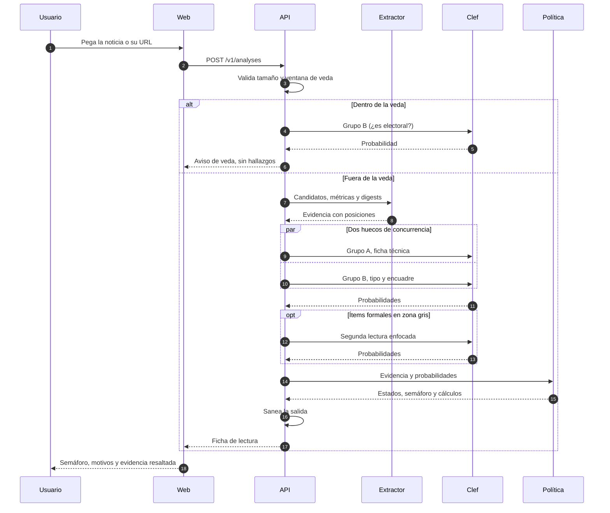
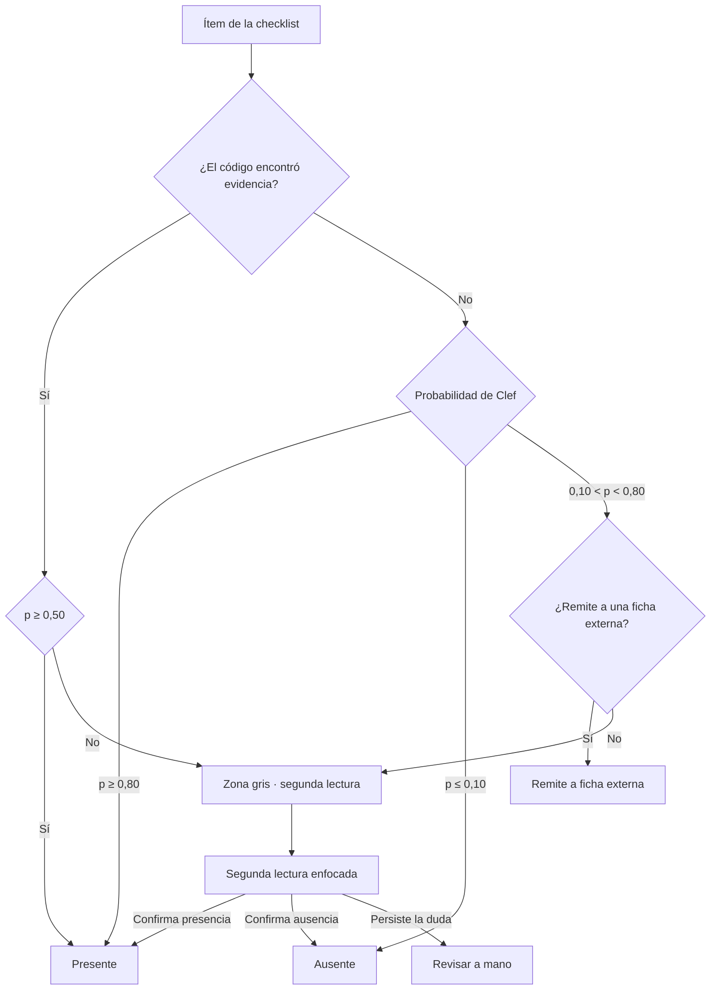
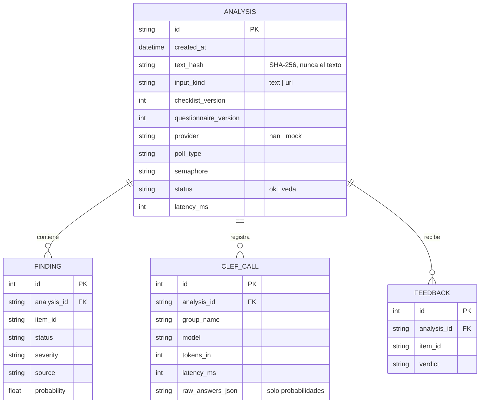

# Ficha Técnica

Aplicación de lectura crítica de noticias sobre encuestas electorales. Recibe el texto de
una noticia —o su URL— y devuelve una **ficha de lectura** que indica, ítem por ítem, qué
información necesaria para interpretar la encuesta aparece en el texto y cuál falta.

El sistema separa de forma estricta dos responsabilidades: **Clef** interpreta el texto
(¿se menciona la muestra, aunque sea con otras palabras?); el **código determinista** calcula
la aritmética, aplica las reglas y sanea la salida. Ninguna decisión de umbral se delega al
modelo.

## Qué es y qué no es

| Es | No es |
|---|---|
| Una comprobación de la información que una noticia aporta sobre una encuesta | Un verificador de la calidad de la encuesta ni de la casa que la realizó |
| Una ayuda de lectura con umbrales publicados y auditables | Un asesor jurídico: la valoración corresponde a la Junta Electoral Central |
| Un sistema que prefiere abstenerse antes que acusar | Un predictor electoral ni un comparador de partidos |

Proyecto desarrollado para el hackathon #2 de NaN, *Decide con Clef*. El diseño completo
está en [`lector-de-encuestas.md`](./lector-de-encuestas.md); la bitácora de desarrollo,
las decisiones y los defectos encontrados, en [`informe.md`](./informe.md).

## Índice

- [Arquitectura](#arquitectura)
- [Flujo de un análisis](#flujo-de-un-análisis)
- [Política de estados](#política-de-estados)
- [Modelo de datos y privacidad](#modelo-de-datos-y-privacidad)
- [Puesta en marcha](#puesta-en-marcha)
- [API](#api)
- [Configuración](#configuración)
- [Evaluación](#evaluación)
- [Calidad y CI](#calidad-y-ci)
- [Estructura del repositorio](#estructura-del-repositorio)
- [Decisiones de diseño y límites conocidos](#decisiones-de-diseño-y-límites-conocidos)
- [Documentación](#documentación)

## Arquitectura

El sistema se despliega como dos procesos independientes: una API en Python y una SPA en
React. La web consume únicamente la API; las claves del modelo nunca salen del servidor.



| Componente | Responsabilidad | Módulo |
|---|---|---|
| Extractor | Localiza cifras, fechas, entidades y frases candidatas con posiciones sobre el texto original | `extractor/` |
| Digests | Comprime el texto en tres estados acotados, uno por grupo de preguntas | `extractor/digest.py` |
| Cliente de decisión | Interfaz única hacia Clef, con adaptadores `nan` y `mock`, semáforo de dos peticiones en vuelo y reintento inmediato ante `429` | `clef_client/` |
| Política | Combina la evidencia del código con las probabilidades y asigna estados y semáforo | `policy/states.py`, `policy/semaphore.py` |
| Calculadora | Margen teórico, coherencia con el declarado y diferencia frente al margen | `policy/calculator.py` |
| Veda | Ventana temporal en la que no se analizan encuestas electorales | `policy/veda.py` |
| Saneador | Enmascara cualquier frase que combine una formación con una cifra | `sanitizer/` |
| Evaluación | Corpus sintético, líneas base y métricas | `evaluation/` |

## Flujo de un análisis

Los grupos A y B se consultan en paralelo porque NaN permite exactamente dos peticiones en
vuelo. La segunda lectura se realiza únicamente cuando hay ítems en duda, con un estado
reducido a la evidencia de esos ítems.



## Política de estados

Los umbrales son asimétricos por diseño: confirmar un dato exige menos certeza que acusar de
omitirlo. Un ítem con evidencia del código **nunca** puede quedar como ausente.



El semáforo describe **la información que da la noticia**, nunca la calidad de la encuesta:
rojo si falta un ítem formal de gravedad alta o salta una regla aritmética; ámbar si falta
uno de gravedad media, hay ítems en revisión o salta un aviso; verde si no ocurre nada de lo
anterior; gris si no parece una encuesta o está activa la veda.

## Modelo de datos y privacidad

El sistema **no almacena el texto de las noticias**. Guarda un hash SHA-256 del contenido, la
configuración aplicada y los resultados. Las respuestas del modelo se persisten como
probabilidades, sin el estado enviado.



La ausencia del texto no se da por supuesta: un test abre el fichero SQLite, recorre todas
las tablas y todas las columnas y busca fragmentos del texto introducido.

## Puesta en marcha

Requisitos: Python 3.14 con [uv](https://docs.astral.sh/uv/) y Node 22 con
[pnpm](https://pnpm.io/).

```bash
# 1. Clave de NaN en un .env que no se versiona
echo 'NAN_KEY=tu-clave' > .env

# 2. API con el modelo real
cd server && uv sync && uv run uvicorn ficha_tecnica.api.app:app --port 8000

# 3. Interfaz web, en otra terminal
pnpm --dir web install && pnpm --dir web dev
```

La aplicación queda disponible en <http://127.0.0.1:5173>. La web redirige `/v1` al backend
mediante el proxy de Vite.

Sin clave configurada, el sistema arranca con el proveedor `mock`, que responde de forma
determinista. Sirve para recorrer el flujo y para los tests, pero **no para medir**: la ficha
lo declara en el campo `provider` y la interfaz lo muestra.

## API

| Método | Ruta | Descripción |
|---|---|---|
| `POST` | `/v1/analyses` | Analiza `{"text": "..."}` o `{"url": "..."}` y devuelve la ficha |
| `GET` | `/v1/analyses/{id}` | Recupera una ficha almacenada, sin el texto original |
| `POST` | `/v1/analyses/{id}/feedback` | Registra la corrección de un ítem (`wrong`, `right`, `unsure`) |
| `GET` | `/v1/checklist` | Lista de comprobación con capa, gravedad y fundamento |
| `GET` | `/v1/config` | Versiones de cuestionario y política, y estado de la veda |
| `GET` | `/v1/health` | Estado del servicio y proveedor en uso |

Códigos de respuesta del modo URL: `400` si el destino está bloqueado por la política de
seguridad, `413` si la página supera el tamaño máximo, `502` si la descarga falla y `422` si
se envían texto y URL a la vez.

El contrato de Clef, verificado contra la API real, está en
[`docs/clef-contract.md`](./docs/clef-contract.md).

## Configuración

Todo lo que define el comportamiento del producto es dato, no código:

| Fichero | Contenido |
|---|---|
| `config/checklist.v1.yaml` | Los quince ítems con su capa (`formal`, `methodological`) y su gravedad |
| `config/questionnaire.v1.yaml` | Las preguntas enviadas a Clef, en tres grupos |
| `config/policy.yaml` | Umbrales asimétricos, ventana de veda y banderas del grupo B |
| `config/pollsters.yaml` | Casas encuestadoras para la capa de evidencia |
| `config/parties.yaml` | Formaciones, con tratamiento idéntico para todas |

Cambiar un umbral es editar `config/policy.yaml`: existe un test que impide que los valores
del fichero y los de por defecto diverjan en silencio.

## Evaluación

El corpus es sintético, con etiquetas correctas por construcción: cuarenta artículos base en
cuatro estilos periodísticos y doscientas cuarenta mutaciones que alteran el contenido de
forma conocida. La mutación M14 es una paráfrasis que **no** cambia las etiquetas: es la que
mide la tasa de falsa acusación.

```bash
cd server && uv run python ../eval/run.py --limit 12 --baseline B4
```

Última medición con el modelo real (12 casos, sistema completo):

| Métrica | Valor | Objetivo |
|---|---|---|
| Tasa de falsa acusación | **0,00 %** (0/165) | ≤ 2 % |
| Recall de omisiones | **86,67 %** | ≥ 85 % |
| Ítems en revisión manual | 10,00 % | ≤ 20 % |
| Exactitud de las reglas M4 y M5 | 1,000 | 100 % |
| Estabilidad entre ejecuciones | 1,000 | ≈ 100 % |
| Fugas del saneador | **0** | 0 |
| Latencia p50 / p95 | 905 / 1479 ms | — |

`--limit` es deliberadamente pequeño: cada caso consume dos o tres llamadas al modelo. Las
líneas base B1 y B2, que requieren un modelo de chat como juez, se reportan como **no
disponibles**: no hay acceso configurado y simular sus cifras invalidaría la comparación.

## Calidad y CI

```bash
cd server && uv run ruff check . && uv run ruff format --check . && uv run pyright && uv run pytest
pnpm --dir web lint && pnpm --dir web typecheck && pnpm --dir web build
```

- **Más de 540 pruebas** en el backend, con `ruff` y `pyright` en modo estricto. El
  recuento exacto crece con las listas curadas, porque parte de la suite se parametriza
  sobre `config/parties.yaml` y `config/pollsters.yaml`.
- Integración continua en cada push a `dev` y en cada pull request, con dos trabajos: backend
  y web.
- Los tests de seguridad y concurrencia se validan por mutación: se retira la protección y se
  comprueba que el test falla.

## Estructura del repositorio

```
server/
  src/ficha_tecnica/
    api/          rutas, pipeline, persistencia y fetch seguro
    clef_client/  DecisionProvider: adaptadores nan y mock
    extractor/    parser español, entidades, candidatos y digests
    policy/       estados, semáforo, calculadora y veda
    sanitizer/    enmascarado y detector independiente
    schema/       modelos Pydantic del informe y de la configuración
    evaluation/   corpus, líneas base y métricas
  tests/          suite del backend y fixtures reales de Clef
web/              SPA de React
config/           checklist, cuestionario, política y listas curadas
eval/             interfaz de línea de comandos del harness
odd/tasks/        documentos de tarea
docs/             contrato de Clef y guion de demostración
```

## Decisiones de diseño y límites conocidos

Decisiones que conviene conocer antes de modificar el sistema:

- **La asimetría es una propiedad, no un parámetro.** Con evidencia del código, un ítem no
  puede quedar como ausente; la duda se resuelve como revisión manual. Hay un test que lo
  comprueba incluso con probabilidad cero.
- **El saneador y su detector están construidos de forma independiente.** Compartir la lógica
  haría que un punto ciego común produjese un informe de "cero fugas" mientras el sistema
  filtra.
- **Lo que el diseño no define no se inventa.** Las reglas M6, M7 y M9 se aceptan como
  identificadores y permanecen inertes; M12 y M13 se calculan y no colorean el semáforo.

Límites conocidos:

- El modo URL depende de que el medio permita la descarga automatizada; muchos la bloquean.
- La lista de casas encuestadoras es orientativa: una casa ausente sigue siendo reconocida por
  el modelo, con menos evidencia corroborante.
- La ventana exacta de la veda está pendiente de confirmación con la Junta Electoral Central.
- El corpus de evaluación es sintético; no incluye noticias reales etiquetadas a mano.

## Documentación

| Documento | Contenido |
|---|---|
| [`lector-de-encuestas.md`](./lector-de-encuestas.md) | Diseño funcional y técnico completo |
| [`informe.md`](./informe.md) | Objetivo, arquitectura, registro de defectos y mediciones |
| [`docs/clef-contract.md`](./docs/clef-contract.md) | Contrato real de la API de Clef, con fixtures |
| [`docs/guion-demo.md`](./docs/guion-demo.md) | Guion de demostración de tres minutos |
| [`odd/tasks/`](./odd/tasks) | Documento de especificación de cada tarea |

## Flujo de trabajo

`main` contiene lo entregable y solo recibe fusiones desde `dev`, revisadas y aplicadas a
mano. Las ramas de trabajo (`feature/<id>-<slug>`, `fix/*`, `docs/*`, `chore/*`) se integran
en `dev` mediante fusiones `--no-ff`, con los tests y la documentación en el mismo commit que
el comportamiento. Los mensajes siguen Conventional Commits.
