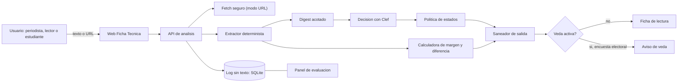
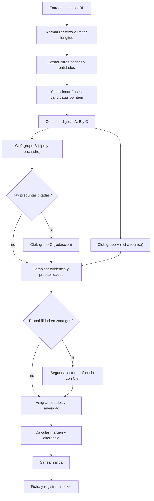
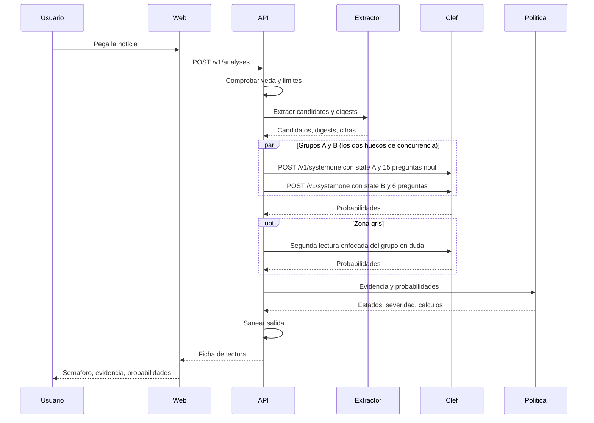
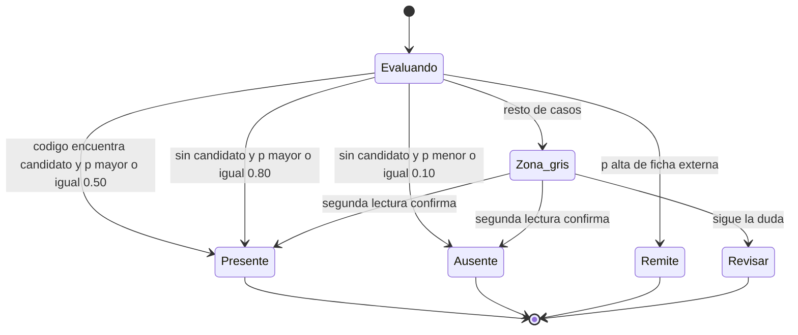
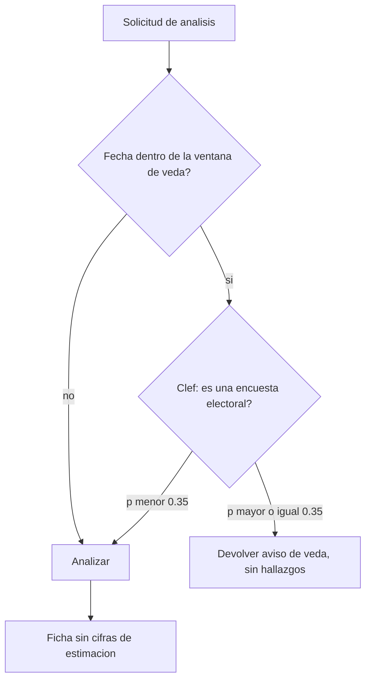
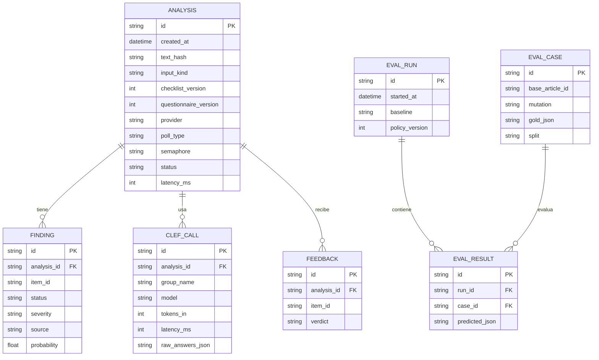
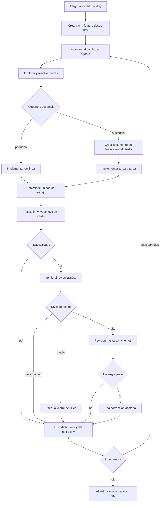
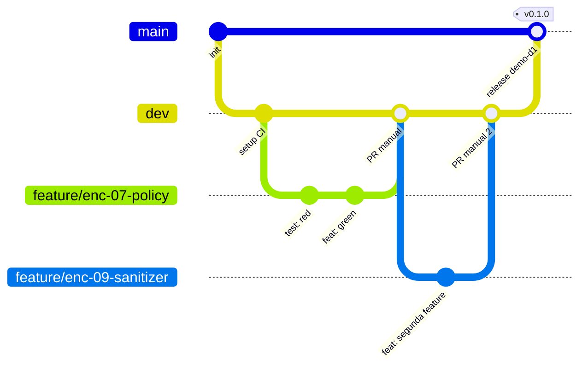

# Ficha Técnica: lector de encuestas electorales

> Una app que lee una noticia sobre una encuesta y dice, ítem por ítem, qué información necesaria para interpretarla aparece y cuál falta. Clef decide qué hay en el texto. El código comprueba la aritmética y las reglas. Nunca juzga si el resultado es verdadero ni a favor de quién.

| | |
|---|---|
| Categoría del reto | Tema libre (cercana a Fact Check, pero sobre el rigor de la información y no sobre la verdad del dato) |
| Hackathon | #2 NaN Hackathon "Decide con Clef": viernes 13 de noviembre de 2026 a las 17:00 al domingo 15 a las 17:00 (hora peninsular), en el Discord de NaN. Equipos de hasta 3 personas |
| Contexto | Elecciones generales del domingo 29 de noviembre de 2026 (Real Decreto 806/2026). Campaña del 13 al 27 de noviembre |
| Modelo de decisión | Clef a través de la API de NaN (`POST /v1/systemone`, `model: "clef"`, misma clave que los modelos de chat) |
| Estado | Diseño v2: backend en Python 3.14, contrato de Clef alineado con el README oficial del hackathon |
| Stack | Backend: Python 3.14, uv, FastAPI y Pydantic v2. Web: React 19, TSX, Tailwind CSS y pnpm |
| Metodología de trabajo | Sección 15 de este documento (ODD, RDD y Git) |
| Proyecto hermano | [enrutador-de-dudas.md](./enrutador-de-dudas.md) (pueden compartir el módulo `clef_client`, los modelos de decisión y el kit de evaluación) |
| Convención | `[VERIFICAR]` marca un dato que no está confirmado en fuentes primarias. `[HIPÓTESIS]` marca una decisión de diseño que se validará con datos |

---

## 1. Resumen

**Ficha Técnica** recibe el texto de una noticia (o su URL) que habla de una encuesta y devuelve una **ficha de lectura** con semáforo:

1. El código **extrae candidatos**: cifras, fechas, nombres de entidades, frases con "muestra", "margen", "trabajo de campo".
2. Construye un **resumen acotado** (digest) del texto, sin guardarlo.
3. Pregunta a **Clef** lo semántico: ¿aparece el tamaño de la muestra?, ¿el método de selección?, ¿qué tipo de encuesta es?, ¿el titular afirma más de lo que dicen los datos?
4. Una **política** combina la evidencia del código con las probabilidades de Clef y decide, por ítem: presente, ausente, remite a otro sitio o **a revisar a mano**.
5. El código añade las **comprobaciones aritméticas**: ¿el margen declarado es coherente con la muestra?, ¿la diferencia entre las dos primeras fuerzas supera el margen?
6. Un **saneador de salida** garantiza que la ficha **no reproduce cifras de estimación de voto**.
7. En el periodo en que la ley prohíbe publicar encuestas, un **interruptor de veda** apaga el análisis de encuestas electorales.

**Frase para el jurado:** "Hay encuestas en todas las noticias y casi nadie comprueba si la noticia da lo necesario para interpretarlas. Ficha Técnica lo hace en un par de segundos, sin opinar sobre el resultado, y prefiere decir 'revisa esto a mano' antes que acusar en falso."

### Qué no es
- **No es un verificador de datos.** No dice si la encuesta es verdadera ni si el resultado es correcto.
- **No es un asesor jurídico.** Aplica una lista de comprobación inspirada en la ley y en guías profesionales. La Junta Electoral Central es quien vela por su cumplimiento.
- **No es un predictor ni compara partidos.** Todas las formaciones se tratan igual y la salida no contiene sus cifras.

### Por qué Clef encaja aquí
- Cada ítem es una **pregunta de sí/no sobre un texto** ("¿se indica el tamaño de la muestra?"), justo el formato `noul` de Clef: devuelve una probabilidad en una sola pasada.
- Las probabilidades permiten una política **asimétrica**: acusar de omisión exige mucha más certeza que dar algo por presente, y la zona gris se enseña como "a revisar".
- El cuestionario es **versionado y auditable**, a diferencia de un juez LLM cuyo veredicto cambia al repetir la ejecución.

---

## 2. Alcance

### Dentro
- Entrada por **texto pegado** (modo principal) y por **URL** (modo secundario, con descarga segura).
- Lista de comprobación v1 en dos capas: **formal** (especificaciones del artículo 69 de la LOREG) y **metodológica** (guías profesionales).
- Extracción determinista, digest acotado, cuestionario Clef, segunda lectura enfocada, política, comprobaciones aritméticas.
- Saneador de salida y modo veda.
- Interfaz web con ficha, evidencia y probabilidades. API REST.
- Evaluación con un **dataset sintético con mutaciones** (etiquetas por construcción) y baselines.

### Fuera (extensiones si sobra tiempo)
- Comparar la noticia con la ficha técnica original (qué información se perdió por el camino).
- Extensión de navegador.
- Análisis de gráficos o imágenes de encuestas.
- Otras lenguas cooficiales.
- Estimación de calidad de la casa encuestadora.

---

## 3. Reparto de responsabilidades

| Capa | Decide | Motivo |
|---|---|---|
| Código determinista | Localizar cifras, fechas y nombres. Calcular márgenes y diferencias. Aplicar saneado, veda y límites | Son hechos o aritmética. No se preguntan a un modelo |
| Clef | Si un dato está presente aunque esté redactado de otra forma, tipo de encuesta, encuadre del titular, preguntas tendenciosas | Es interpretación semántica del texto |
| Política (código) | Umbrales, estados, severidad, cuándo pedir una segunda lectura, cuándo abstenerse | Reglas editables y testeables |
| Humano | Interpretar la ficha y, si procede, contactar a la fuente | La app no emite juicios sobre personas ni medios |

**Si se puede decidir con código, se decide con código.** Clef se queda con lo que exige leer el sentido.

---

## 4. Marco: qué exige la ley y qué recomiendan las guías

La lista de comprobación tiene dos capas que **no se mezclan en la interfaz**, porque no pesan lo mismo.

### 4.1 Capa formal (artículo 69 de la LOREG)
Según el texto vigente publicado por la Junta Electoral Central, quien realiza un sondeo debe acompañarlo de especificaciones que también deben incluir sus publicaciones:

| Especificación | Fuente |
|---|---|
| Denominación y domicilio de quien realizó el sondeo y de quien lo encargó | art. 69.1.a |
| Características técnicas: sistema de muestreo, tamaño de la muestra, margen de error, nivel de representatividad, procedimiento de selección de los encuestados y fecha del trabajo de campo | art. 69.1.b |
| Texto íntegro de las preguntas y número de personas que no contestaron a cada una | art. 69.1 (según la doctrina de la JEC) `[VERIFICAR letra exacta]` |

Otros puntos del artículo que afectan al diseño:
- La JEC vela por que los datos publicados no tengan falsificaciones, ocultaciones o modificaciones deliberadas y por el cumplimiento de estas especificaciones (art. 69.2), y puede pedir información técnica complementaria (art. 69.3).
- **Durante los cinco días anteriores a la votación queda prohibido publicar, difundir o reproducir sondeos electorales** por cualquier medio (art. 69.7). La JEC aplica esa prohibición también a encuestas sobre otras elecciones mientras dura el periodo.
- Los organismos dependientes de administraciones públicas que hagan encuestas de intención de voto en periodo electoral tienen obligaciones adicionales (art. 69.8 e Instrucción 1/2024 de la JEC). Quedan fuera de esta herramienta.

> Ficha Técnica **no aplica la ley**. Marca con la etiqueta "formal" los ítems que coinciden con esas especificaciones y avisa en cada informe de que la valoración jurídica corresponde a la JEC.

### 4.2 Capa metodológica (guías profesionales)
Se basa en guías para periodistas de AAPOR, Roper Center (20 preguntas), Journalist's Resource y ESOMAR/WAPOR. Ejemplos usados:
- El margen de error de una muestra aleatoria afecta a la estimación de **cada** candidato. Una ventaja suele necesitar entre 1,5 y 2 veces el margen para ser estadísticamente significativa (AAPOR).
- Si la ventaja es de 2 puntos y el margen es de ±3, el segundo podría ir por delante (Journalist's Resource).
- Los márgenes de error de subgrupos son mayores que el de la muestra total.
- AAPOR indica que el margen de error no debería publicarse para muestras no probabilísticas (por ejemplo paneles online).
- Una encuesta es una foto de un momento, no una predicción.

Estas guías son **orientativas y de origen mayoritariamente estadounidense**. La capa metodológica se etiqueta como "nota" o "metodología", nunca como incumplimiento.

### 4.3 Fechas relevantes (todas `[VERIFICAR]` en el calendario oficial de la JEC)
| Fecha | Hecho |
|---|---|
| Vie 13 nov | Empieza la campaña y la hackathon |
| Vie 27 nov | Termina la campaña |
| Mar 24 a sáb 28 nov | Cinco días previos a la votación: prohibida la publicación de encuestas (cómputo propio, comprobar) |
| Dom 29 nov | Votación |
| Lun 30 nov | Se puede volver a publicar según el criterio de la JEC |

---

## 5. Arquitectura

### 5.1 Vista de contexto



### 5.2 Componentes

| Componente | Responsabilidad | Módulo |
|---|---|---|
| Parser numérico y de fechas | Interpreta formato español (`1.200`, `2,8 %`, "del 3 al 9 de noviembre") | `ficha_tecnica/extractor` |
| Extractor de candidatos | Localiza frases candidatas por ítem y entidades de una lista curada | `ficha_tecnica/extractor` |
| Digest builder | Compone el `state` acotado para cada grupo de preguntas | `ficha_tecnica/extractor` |
| DecisionProvider | Interfaz única hacia Clef: adaptadores `nan` y `mock`, con semáforo de 2 peticiones en vuelo | `ficha_tecnica/clef_client` |
| Política | Combina evidencia del código y probabilidades, asigna estados y severidad | `ficha_tecnica/policy` |
| Calculadora | Margen teórico, coherencia, diferencia frente al margen | `ficha_tecnica/policy` |
| Saneador | Enmascara cifras de estimación de voto en cualquier texto de salida | `ficha_tecnica/sanitizer` |
| Veda | Interruptor por fecha para encuestas electorales | `ficha_tecnica/policy` |
| API | `/v1/analyses` y utilidades (FastAPI) | `ficha_tecnica/api` |
| Web | Pegar texto, ver ficha, evidencia y probabilidades | `web/` (React 19) |
| Evaluación | Dataset sintético, mutaciones, baselines y métricas | `eval/` |

### 5.3 Pipeline de un análisis



### 5.4 Secuencia



### 5.5 Estados de un ítem



### 5.6 Modo veda



---

## 6. Contrato con Clef

Clef se llama en `POST https://api.nan.builders/v1/systemone` con `Authorization: Bearer $NAN_KEY` (la misma clave que los modelos de chat) y `model: "clef"`, el único modelo disponible. El cuerpo lleva `state` (una **cadena**, hasta unos 16k tokens) y `questions` (un objeto `id -> pregunta` con `type`, `instructions` y `criteria`).

| Límite o dato | Valor |
|---|---|
| Concurrencia | Máximo 2 peticiones a la vez por persona. Si se supera, `429`: reintentar al momento |
| Tamaño de la petición | 4 MiB |
| Latencia | 0,3 a 0,5 s solo con texto (1 a 2 s con imágenes) |
| Errores | `401` clave inválida, `429` concurrencia, `413` y `400` petición grande o mal formada (usar siempre comillas rectas `"`) |

**El formato del JSON de respuesta no está documentado.** Primera llamada de prueba con el cuestionario v1, respuesta real guardada en `server/tests/fixtures/clef/` y parser escrito contra esas fixtures `[VERIFICAR]`. Todo lo que dependa de ese formato vive en el adaptador `nan`.

Cliente de referencia (Python 3.14), basado en el ejemplo oficial `examples/clef.py` pero asíncrono. Con 3.14 las anotaciones se evalúan de forma diferida (PEP 649), así que no hace falta `from __future__ import annotations`.

```python
# server/src/ficha_tecnica/clef_client/nan.py
import asyncio
import os

import httpx

URL = "https://api.nan.builders/v1/systemone"
_en_vuelo = asyncio.Semaphore(2)  # NaN admite 2 peticiones simultáneas por persona


async def ask_clef(client: httpx.AsyncClient, state: str, questions: dict, timeout: float = 10) -> dict:
    body = {"model": "clef", "state": state, "questions": questions}
    headers = {"Authorization": f"Bearer {os.environ['NAN_KEY']}"}
    async with _en_vuelo:
        for _ in range(5):
            r = await client.post(URL, json=body, headers=headers, timeout=timeout)
            if r.status_code == 429:  # demasiadas en vuelo: reintentar al momento
                await asyncio.sleep(0.2)
                continue
            r.raise_for_status()
            return r.json()
    raise RuntimeError("Clef: 429 sostenido")
```

### 6.1 Qué hace el código antes de preguntar

| Extracción | Método |
|---|---|
| Tamaño de muestra | Patrones `n = 1.200`, "1.200 entrevistas", "muestra de 1.200 personas" |
| Margen de error | Patrones `±2,8`, "margen de error de 2,8 puntos", "error muestral" |
| Nivel de confianza | `95 %`, `95,5 %`, "nivel de confianza" |
| Fechas de campo | "entre el 3 y el 9 de noviembre", "del 3 al 9 de nov." |
| Entidades | Lista curada de casas encuestadoras y organismos (`config/pollsters.yaml`, **a mantener y revisar**) y patrones "realizada por", "encargada por" |
| Cifras de estimación | Un porcentaje o número de escaños junto a una formación de `config/parties.yaml` (lista completa, trato idéntico) |
| Preguntas citadas | Frases entre comillas que acaban en `?` o que siguen a "se preguntó" |

El resultado son **candidatos por ítem**: frases con posición. No se interpreta nada todavía.

### 6.2 State enviado a Clef (digest acotado)

El texto se acota: Clef admite unos 16k tokens, pero menos ruido da mejores decisiones y menos latencia. `state` es una cadena: cada digest se serializa a JSON compacto antes de enviarlo. El digest A mezcla titular, arranque y las frases con dígitos o palabras clave (muestra, entrevist, margen, error, campo, encuesta, ficha, universo, confianza), sin duplicados:

```json
{
  "headline": "...",
  "lede": "...maximo 120 tokens...",
  "technical_sentences": ["...", "..."],
  "meta": { "language": "es", "chars": 4210, "digest_tokens": 880 }
}
```

| Digest | Contenido | Presupuesto |
|---|---|---|
| A (ficha técnica) | Titular, arranque, frases técnicas | 1.200 tokens |
| B (tipo y encuadre) | Titular, arranque, hasta 6 frases con cifras (en el interior, **sin sanear**, porque el saneado solo afecta a la salida) | 500 tokens |
| C (redacción) | Preguntas citadas | 400 tokens |

Las frases candidatas de un ítem sin candidatos no se inventan: si el código no encuentra nada, Clef responde igualmente sobre el digest A y la política lo tiene en cuenta (véase 7.2).

### 6.3 Cuestionario v1

**Grupo A: ficha técnica** (todas `noul`, una llamada)

| Id | Instrucción | Capa |
|---|---|---|
| `a_entity` | ¿El texto dice qué empresa u organismo realizó la encuesta? | Formal |
| `a_entity_address` | ¿El texto indica el domicilio o la sede de quien realizó la encuesta? | Formal |
| `a_client` | ¿El texto dice quién encargó o financió la encuesta? | Formal |
| `a_sample_size` | ¿El texto indica cuántas personas fueron entrevistadas? | Formal |
| `a_margin` | ¿El texto indica un margen de error de la encuesta? | Formal |
| `a_confidence` | ¿El texto indica el nivel de confianza del margen de error? | Metodológica |
| `a_universe` | ¿El texto indica a qué población representa la encuesta (ámbito y universo)? | Formal |
| `a_sampling_system` | ¿El texto explica el sistema de muestreo (aleatorio, estratificado, por cuotas, panel)? | Formal |
| `a_selection_procedure` | ¿El texto explica cómo se seleccionó o contactó a las personas encuestadas? | Formal |
| `a_mode` | ¿El texto indica cómo se hicieron las entrevistas (teléfono, internet, cara a cara)? | Metodológica |
| `a_fieldwork_dates` | ¿El texto indica en qué fechas se hicieron las entrevistas? | Formal |
| `a_question_text` | ¿El texto reproduce la redacción exacta de las preguntas? | Formal |
| `a_nonresponse` | ¿El texto indica cuántas personas no contestaron a cada pregunta? | Formal |
| `a_weighting` | ¿El texto menciona que los datos se ponderaron? | Metodológica |
| `a_external_sheet` | ¿El texto remite a una ficha técnica publicada en otro sitio? | Auxiliar |

**Grupo B: tipo y encuadre**

| Id | Tipo | Instrucción | Criterios |
|---|---|---|---|
| `b_poll_type` | `choice` | ¿Qué tipo de sondeo describe el texto? | `voting_intention_estimate`, `direct_voting_intention`, `leader_ratings`, `issue_opinion`, `self_selected_online_poll`, `poll_of_polls_or_model`, `not_a_poll` con una descripción corta cada uno |
| `b_is_electoral` | `noul` | ¿El texto trata de intención de voto o de resultados de unas elecciones? | |
| `b_prediction` | `noul` | ¿El texto presenta los resultados como una predicción del resultado de las elecciones y no como una foto del momento? | |
| `b_lead_decisive` | `noul` | ¿El titular o el arranque presenta a una fuerza como claramente por delante o ganadora? | |
| `b_headline_overreach` | `score` | ¿Cuánto afirma el titular más de lo que sostienen los datos del texto? | `["Nada","Poco","Algo","Bastante","Mucho"]` |
| `b_subgroup` | `noul` | ¿El texto presenta los resultados de un subgrupo pequeño (una provincia, un tramo de edad) como si valieran para toda la población? | |

**Grupo C: redacción** (solo si `a_question_text` ≥ 0,80 y hay preguntas citadas)

| Id | Tipo | Instrucción |
|---|---|---|
| `c_leading` | `noul` | ¿La redacción de la pregunta empuja hacia una respuesta concreta? |
| `c_loaded_terms` | `noul` | ¿La pregunta usa términos valorativos o emocionales sobre alguna opción? |

Se espera una probabilidad de "sí" en `noul`, una probabilidad por opción en `choice` y una distribución por nivel en `score`, pero los nombres de los campos se confirman con las fixtures reales. Las probabilidades cerca de 0,5 suelen indicar una pregunta ambigua: se revisan los criterios, no se culpa al modelo.

### 6.4 Segunda lectura enfocada y concurrencia

1. Se pregunta a **Clef** una vez por grupo (A, B y, si hay preguntas citadas, C).
2. Si algún ítem queda en la zona gris `[0,20, 0,80]` y es de capa formal, se repite **solo ese grupo** con una **segunda lectura enfocada**: el `state` se reduce a las frases candidatas del ítem y a su contexto inmediato, que da menos ruido que el digest completo.
3. Si sigue en zona gris: estado **Revisar**. No se fuerza una respuesta.
4. Clef no devuelve posiciones de texto. La **evidencia mostrada** son las frases candidatas que el código seleccionó para el ítem `[HIPÓTESIS: suficiente para el usuario]`.
5. Concurrencia: los grupos A y B se lanzan a la vez y ocupan los dos huecos del límite de NaN. C y la segunda lectura van después. Con 0,3 a 0,5 s por llamada, una ficha tarda unos 1 a 1,5 s `[HIPÓTESIS]`. Varios usuarios simultáneos se encolan en un semáforo global de 2.

| Candidato del código | p(presente) de Clef | Estado |
|---|---|---|
| Sí | ≥ 0,50 | **Presente** (código y Clef) |
| Sí | < 0,50 | Zona gris, segunda lectura |
| No | ≥ 0,80 | **Presente** (solo Clef) |
| No | ≤ 0,10 | **Ausente** |
| No | entre 0,10 y 0,80 | Zona gris, segunda lectura |
| Cualquiera | `a_external_sheet` ≥ 0,80 y p(ítem) < 0,50 | **Remite** a ficha externa |
| Zona gris tras la segunda lectura | | **Revisar** |

Un ítem **Ausente** solo se marca así si además el código no encontró ni un solo candidato. Un ítem **Remite** se muestra aparte: la valoración de si eso basta pertenece a la JEC `[VERIFICAR doctrina]`.

```yaml
policy:
  version: 1
  thresholds:
    present_with_candidate: 0.50
    present_without_candidate: 0.80
    absent_max: 0.10
    gray_band: [0.20, 0.80]
  second_reading_for_layers: [formal]
  headline_overreach_flag_min_score: 3
  prediction_flag_min_p: 0.70
  subgroup_flag_min_p: 0.70
  self_selected_flag_min_p: 0.60
```

### 7.3 Reglas aritméticas (código)

**M4. Coherencia del margen.** Con muestreo aleatorio simple y confianza del 95 %, el margen máximo es `e = z * sqrt(0,25 / n)`, con `z = 1,96` (o 2,0 si el texto dice 95,5 %). Aproximaciones:

| n | e (puntos, 95 %) |
|---|---|
| 400 | 4,9 |
| 600 | 4,0 |
| 800 | 3,5 |
| 1.000 | 3,1 |
| 1.200 | 2,8 |
| 1.500 | 2,5 |
| 2.000 | 2,2 |
| 2.400 | 2,0 |
| 3.000 | 1,8 |

- Si el margen declarado es **menor** que el 90 % del teórico para esa `n`: hallazgo "margen más pequeño que el mínimo teórico con muestreo aleatorio simple". Es un aviso, no un error: el diseño real puede diferir.
- Si es **mayor**, es normal (efectos del diseño muestral) y no se marca.
- Para subgrupos con `n` propia, el margen se recalcula y se muestra.

**M5. Diferencia frente al margen.** Con `lead` la diferencia entre las dos cifras más altas que cita el texto y `m` el margen declarado:

| `r = lead / m` | Lectura |
|---|---|
| r < 1 | "La diferencia está dentro del margen" |
| 1 ≤ r < 2 | "No concluyente según el criterio de AAPOR (se suele pedir entre 1,5 y 2 veces el margen)" |
| r ≥ 2 | "Probablemente real, bajo los supuestos de muestreo aleatorio" |

El hallazgo **M5** salta si `r < 2` y `b_lead_decisive` ≥ 0,70. La salida habla de "las dos primeras fuerzas que cita el texto" sin nombrarlas ni dar sus cifras.

### 7.4 Severidad y semáforo

| Resultado | Condición |
|---|---|
| Rojo | Falta algún ítem formal de gravedad alta, o salta M5 o M11 |
| Ámbar | Falta algún ítem formal de gravedad media, o hay ítems en Revisar, o saltan M4, M6, M7 o M9 |
| Verde | Nada de lo anterior |
| Gris | No es una encuesta (`not_a_poll`) o veda |

El semáforo describe **la información que da la noticia**, no la calidad de la encuesta ni de la casa que la hizo.

### 7.5 Saneador de salida

Regla dura, siempre activa e independiente de la veda: **ninguna parte de la respuesta contiene cifras de estimación de voto ni de escaños asociadas a una formación**.

- Se enmascara cualquier frase de salida que combine una formación (de `config/parties.yaml`) con un número, un porcentaje o la palabra "escaños". Se sustituye por `[cifra de estimación omitida]`.
- La API devuelve **posiciones** (`start`, `end`) en el texto de entrada, no copias de frases. En modo texto, el cliente recorta de su propia entrada. En modo URL, el servidor devuelve el texto de la noticia ya saneado.
- Los hallazgos de margen y diferencia se expresan con razones (`r`), no con las cifras.
- Test obligatorio: ninguna salida de la suite de evaluación pasa un detector independiente de "formación + porcentaje".

### 7.6 Veda `[VERIFICAR]`

La ley prohíbe publicar, difundir o reproducir sondeos electorales durante los cinco días anteriores a la votación. Aunque analizar una noticia no es publicarla, el diseño es **conservador**:

```yaml
veda:
  mode: strict          # strict | off
  start: "2026-11-24T00:00:00+01:00"
  end:   "2026-11-30T00:00:00+01:00"
  block_if_p_electoral_at_least: 0.35
```

En modo `strict` y dentro de la ventana, si `b_is_electoral` ≥ 0,35 o `b_poll_type` apunta a intención de voto, la API responde con un aviso de veda y **sin hallazgos**. Las encuestas de otros temas siguen analizándose. La ventana se lee de configuración, no del reloj del navegador. En la demo se puede simular con `VEDA_NOW=2026-11-25T10:00:00+01:00`.

---

## 8. API

| Método y ruta | Descripción |
|---|---|
| `POST /v1/analyses` | Cuerpo `{ "text": "..."}` o `{ "url": "..."}`. Devuelve la ficha |
| `GET /v1/analyses/:id` | Recupera una ficha (sin texto original) |
| `POST /v1/analyses/:id/feedback` | El usuario marca un ítem como incorrecto (alimenta la evaluación) |
| `GET /v1/checklist` | Lista de comprobación v1 con base y capa de cada ítem |
| `GET /v1/config` | Versión del cuestionario, política y estado de la veda |
| `POST /v1/eval/run` | Lanza una evaluación contra un dataset |
| `GET /v1/health` | Estado de proveedores y latencias |

```python
# server/src/ficha_tecnica/schema/report.py
from typing import Literal

from pydantic import BaseModel

ItemStatus = Literal["present", "absent", "refers_external", "review"]
Layer = Literal["formal", "methodological"]


class Span(BaseModel):
    start: int
    end: int


class Finding(BaseModel):
    item_id: str                       # "L4", "M5", ...
    layer: Layer
    status: ItemStatus
    severity: Literal["high", "medium", "low", "note"]
    source: Literal["code", "clef", "both", "computation"]
    probability: float | None = None   # p(presente) de Clef
    evidence: list[Span]               # posiciones en la entrada
    message: str                       # texto fijo de la plantilla, sin cifras de voto


class Computation(BaseModel):
    sample_size: int | None = None
    declared_margin: float | None = None
    theoretical_margin: float | None = None
    lead_ratio: float | None = None


class Report(BaseModel):
    id: str
    checklist_version: int
    questionnaire_version: int
    provider: Literal["nan", "mock"]
    poll_type: str                     # distribución en `poll_type_probs`
    semaphore: Literal["red", "amber", "green", "grey"]
    status: Literal["ok", "veda"]
    findings: list[Finding]
    computation: Computation | None = None
    disclaimer: str                    # "No es asesoramiento jurídico..."
    latency_ms: int
```

Los modelos Pydantic son la fuente de verdad: la web genera sus tipos desde el OpenAPI de FastAPI (`openapi-typescript`).

---

## 9. Modelo de datos

El sistema **no guarda el texto de las noticias**. Guarda un hash, la configuración usada y los resultados.



`raw_answers_json` guarda **solo probabilidades**, nunca el digest.

---

## 10. Interfaz

| Pantalla | Contenido |
|---|---|
| Inicio | Caja para pegar el texto, botón de ejemplo ("simulación" etiquetada) y aviso de que no es asesoramiento jurídico |
| Ficha | Semáforo grande, dos bloques (formal y metodológica) con filas por ítem: icono de estado, nombre, motivo en una línea |
| Evidencia | Al abrir una fila se resaltan en el texto las frases candidatas. Un cajón enseña las probabilidades de Clef y su versión de cuestionario |
| "Revisar a mano" | Estado visible y explicado: "no estamos seguros, mira esta frase" |
| Veda | Pantalla de aviso con la fecha y la razón, sin hallazgos |
| Panel (interno) | Matriz de confusión por ítem, tasa de falsa acusación, ítems más inciertos, latencias |

Principios: **nunca** un número único de "calidad de la encuesta", nunca el nombre de una formación en un hallazgo, y siempre el aviso de que la valoración jurídica es de la JEC.

---

## 11. Evaluación

### 11.1 Dataset con etiquetas por construcción
El mayor riesgo de un lector de este tipo es etiquetar a mano cientos de noticias. En su lugar:

1. Se generan **40 artículos base completos** con un modelo de NaN, en cuatro estilos (agencia, diario local, resumen de televisión, hilo de red social). Cada uno incluye todos los ítems de la ficha técnica.
2. **Todas las entidades y formaciones son ficticias** (por ejemplo "Demoscopia Ficticia S.L.", "Partido Azul") y cada texto lleva la marca "SIMULACIÓN". Ningún texto sintético puede confundirse con una encuesta real, y no se publican fuera del repositorio.
3. A cada base se le aplican **mutaciones** que cambian de forma conocida las etiquetas:

| Mutación | Cambio esperado |
|---|---|
| M1 a M9 | Elimina un ítem formal concreto (tamaño, margen, fechas, entidad, cliente, universo, muestreo, preguntas, no respuesta) |
| M10 | Cambia el margen a la mitad del mínimo teórico |
| M11 | Reescribe el titular como victoria clara con diferencia menor que el margen |
| M12 | Presenta los resultados como predicción |
| M13 | Convierte la encuesta en una votación abierta de lectores manteniendo un "margen de error" |
| M14 | **Paráfrasis sin cambio de contenido** ("error muestral" por "margen de error", "entrevistas" por "muestra"). Las etiquetas **no** cambian |
| M15 | Sustituye la ficha por un enlace "más datos en la web de la encuestadora" |

Con unas 6 mutaciones por base salen unos **240 casos** con etiquetas gratis. La **mutación M14 mide la falsa acusación**: si el sistema dice que falta algo que solo se reescribió, falló.

4. Un conjunto pequeño de **20 a 25 noticias reales** se etiqueta a mano **solo con URL y etiquetas** (no se redistribuye el texto) y se evalúa en local.

Se separan `dev` (60 %) y `test` (40 %) **por artículo base**, no por caso, para que mutaciones del mismo texto no crucen el corte.

### 11.2 Baselines

| Id | Sistema |
|---|---|
| B0 | Solo reglas y expresiones regulares |
| B1 | LLM de NaN como juez, con la misma lista de comprobación en JSON, sin razonamiento |
| B2 | LLM de NaN como juez con razonamiento alto |
| B3 | Reglas más Clef con una sola lectura |
| B4 | Reglas más Clef con segunda lectura enfocada (sistema completo) |

### 11.3 Métricas

| Métrica | Objetivo `[HIPÓTESIS]` |
|---|---|
| **Tasa de falsa acusación** (Ausente donde el gold es Presente) | ≤ 2 % |
| Recall de omisiones reales | ≥ 85 % en P0 |
| F1 por ítem | Informativo |
| Fracción de ítems en Revisar | ≤ 20 % |
| Exactitud de M4 y M5 (código) | 100 % sobre casos sintéticos |
| Calibración (error esperado de calibración) de las probabilidades de Clef | Informativo |
| Estabilidad (acuerdo entre dos ejecuciones iguales) | Clef ≈ 100 %, jueces LLM por debajo |
| Latencia p50 y p95 | Frente a B1 y B2 |
| Fugas del saneador | **0** en toda la suite |

### 11.4 Qué se muestra en la demo
Una gráfica de **tasa de falsa acusación contra latencia** para B0 a B4, y la tabla de estabilidad. Lo que se defiende es "mismo o mejor criterio, mucho más rápido y repetible", no "más listo que un LLM grande". Si los resultados no lo respaldan, se cuentan tal cual.

---

## 12. Seguridad, privacidad y aspectos legales

| Riesgo | Medida |
|---|---|
| Reproducir cifras de estimación de voto | Saneador siempre activo y test de fugas (7.5) |
| Publicar encuestas en la veda | Interruptor por fecha, conservador (7.6) `[VERIFICAR con la JEC o asesoría]` |
| Que la app se tome como autoridad | Aviso en todas las pantallas, sin logos ni nombres oficiales, sin número único de calidad |
| Acusar en falso a un medio | Umbrales asimétricos, estado "Revisar", dos capas separadas |
| Sesgo político percibido | Trato idéntico a todas las formaciones, salida sin cifras ni nombres, umbrales publicados |
| SSRF en el modo URL | Resolver DNS y bloquear redes privadas y locales, límite de tamaño y de redirecciones, tiempo máximo, solo HTTP(S) |
| Derechos de autor del texto | No se guarda el texto. Cache con tiempo de vida corto en memoria. Dataset real solo con URL y etiquetas |
| Inyección en el texto de la noticia | Clef no sigue instrucciones del texto, solo contesta preguntas. Aun así, el texto se escapa en la interfaz |
| Claves | `NAN_KEY` solo en `.env`, nunca en el cliente |
| Abuso público | Límite de peticiones por IP y tamaño máximo de texto |

---

## 13. Stack y estructura del repositorio

| Capa | Elección |
|---|---|
| Lenguaje | Python 3.14 en el backend y TypeScript solo en `web/` |
| Gestor | uv (backend) y pnpm (web) |
| API | FastAPI con uvicorn, validación con Pydantic v2 |
| Base de datos | SQLite (`aiosqlite`) |
| Extracción de texto de URL | `trafilatura` (o `readability-lxml`) tras el fetch seguro con `httpx` `[VERIFICAR]` |
| Web | React 19 con TypeScript (TSX), Vite y Tailwind CSS v4 (SPA, sin SSR) |
| Pruebas | pytest, pytest-asyncio, respx y un test de contrato con fixtures reales de Clef |
| Calidad | ruff y pyright |
| CI | GitHub Actions: ruff, pyright y pytest para el backend. Lint, typecheck y build para la web |

Versiones mínimas con soporte de 3.14 anunciado: Pydantic 2.12, FastAPI 0.118.3, uvicorn 0.38 y ruff 0.14.2 `[VERIFICAR versiones el primer día]`. Se usa el intérprete estándar con GIL: el modo free-threaded (PEP 779) no hace falta y FastAPI aún no lo declara `[VERIFICAR]`.

Arranque rápido del backend:

```bash
uv python install 3.14
uv init --package --python 3.14 server
cd server
uv add fastapi "uvicorn[standard]" pydantic httpx aiosqlite pyyaml trafilatura
uv add --dev pytest pytest-asyncio respx ruff pyright
```

Arranque rápido de la web (pnpm, React 19, Vite y Tailwind CSS) `[VERIFICAR versiones el primer día]`:

```bash
pnpm create vite web --template react-ts
pnpm --dir web add tailwindcss @tailwindcss/vite
pnpm --dir web add -D openapi-typescript
# vite.config.ts: añadir tailwindcss() a plugins y un proxy de /v1 hacia http://localhost:8000
# src/index.css: @import "tailwindcss";
```

```text
.
├── server/
│   ├── pyproject.toml        # uv, ruff, pyright, pytest
│   ├── src/ficha_tecnica/
│   │   ├── schema/           # modelos Pydantic: Report, Finding, Checklist
│   │   ├── extractor/        # parser ES, candidatos, digests
│   │   ├── clef_client/      # DecisionProvider: nan, mock (semaforo de 2)
│   │   ├── policy/           # umbrales, estados, calculadora, veda
│   │   ├── sanitizer/        # enmascarado de cifras de estimacion
│   │   └── api/              # FastAPI: /v1/analyses y utilidades
│   └── tests/
│       └── fixtures/clef/    # respuestas reales capturadas de Clef
├── web/                      # React 19 + TSX + Vite + Tailwind: pegar, ficha, evidencia
├── config/
│   ├── checklist.v1.yaml
│   ├── questionnaire.v1.yaml
│   ├── policy.yaml
│   ├── pollsters.yaml        # a curar y revisar
│   └── parties.yaml          # lista completa, trato identico
├── eval/
│   ├── base-articles/        # sinteticos y ficticios
│   ├── mutations/
│   ├── real/                 # solo URL y etiquetas
│   └── run.py
├── odd/tasks/                # documentos de feature (ODD)
├── docs/
└── .githooks/
```

---

## 14. Backlog inicial (para ODD)

"Riesgo RDD" es la expectativa para la revisión nativa. Todo lo que toca el saneador, la veda, los umbrales de acusación y la descarga de URLs se considera de riesgo alto.

| Id | Tarea | Criterio de aceptación | Riesgo RDD |
|---|---|---|---|
| ENC-01 | Estructura del repo (`server/` con uv, `web/` con pnpm) y CI (ruff, pyright, pytest, lint de la web) | `uv run pytest` verde en CI sobre PR a `dev` | Bajo |
| ENC-02 | `DecisionProvider`: cliente `nan` (semáforo de 2, reintento en 429) y `mock`. Primera llamada real y fixtures | Misma interfaz, parser probado con fixtures de respuesta real | Medio |
| ENC-03 | Parser numérico y de fechas en español | `1.200`, `2,8 %`, "del 3 al 9 de noviembre" cubiertos con tests | Medio |
| ENC-04 | Extractor de candidatos por ítem y listas de entidades | Candidatos con posición para los ítems P0 | Medio |
| ENC-05 | Digest builder acotado | Presupuestos de tokens respetados en los tres grupos | Medio |
| ENC-06 | Cuestionario Clef v1 y snapshot | Snapshot del cuestionario y del `state` | Medio |
| ENC-07 | Política de estados con umbrales asimétricos | Tabla 7.2 cubierta con tests, incluida M14 | **Alto** |
| ENC-08 | Calculadora de margen y diferencia | Tabla de `n` y casos límite de `r` | Medio |
| ENC-09 | Saneador de salida y detector independiente | Cero fugas en la suite | **Alto** |
| ENC-10 | Modo veda por fecha | Simulación con `VEDA_NOW` y tests de borde | **Alto** |
| ENC-11 | API `/v1/analyses` y persistencia sin texto | Ningún texto de noticia en la base (test) | **Alto** |
| ENC-12 | Segunda lectura enfocada y zona gris | Los casos de zona gris pasan por la segunda lectura y, si persiste la duda, llegan a "Revisar" | Medio |
| ENC-13 | Modo URL con fetch seguro | Bloqueo de redes privadas y redirecciones | **Alto** |
| ENC-14 | UI: pegar texto y ficha con semáforo | Flujo completo con el ejemplo simulado | Bajo |
| ENC-15 | UI: evidencia, probabilidades y "Revisar" | Resaltado de frases candidatas | Bajo |
| ENC-16 | Generador de artículos base y mutaciones | 40 bases y 240 casos con etiquetas | Medio |
| ENC-17 | Harness de evaluación y baselines B0 a B4 | `uv run python eval/run.py` genera tabla y gráfica | Medio |
| ENC-18 | Pruebas de contrato del cliente `nan` (`429`, `401`, timeout) y cola global de 2 | Fixtures reales y simulación de varios usuarios a la vez | Medio |
| ENC-19 | README, guion y vídeo | Un tercero lo levanta con 3 comandos | Bajo |

---

## 15. Metodología de trabajo: ODD, RDD y Git

Se da por hecho que **gentle-ai y gentle-shell ya están instalados** y que **el repositorio ya existe** (con `main` y `dev`) cuando empieza el hackathon. Esta sección fija cómo se trabaja con ellos y cómo viaja el código hasta `main`, **sin ningún merge automático: fusiona Albert, a mano.**

### 15.1 Principios

1. **Un humano decide qué se fusiona.** Ningún agente, workflow ni regla de GitHub fusiona nada por su cuenta.
2. **Lectura primero.** Preguntas, revisiones y propuestas son de solo lectura. Un agente solo cambia código cuando se le autoriza de forma explícita.
3. **Lo pequeño se queda pequeño.** Lo entendido se hace en línea. Solo el trabajo sustancial deja un registro recuperable.
4. **Se demuestra, no se narra.** Una casilla se marca con evidencia observada: test en rojo y luego en verde, salida de comandos, hash de commit.
5. **Revisión proporcional al riesgo.** RDD revisa a fondo lo que puede hacer daño y deja pasar lo trivial.
6. **Ramas cortas y PRs pequeños** (orientativamente unas 400 líneas de cambio).
7. **Un dueño por pieza.** Cada paquete y cada documento de feature tiene una sola persona responsable.

### 15.2 Comprobaciones al empezar

```bash
gentle-ai doctor
gentle-ai review mode status --cwd .   # ¿RDD activo y desde qué fuente?
gentle-ai sync --dry-run               # no debe quedar nada del SDD antiguo
```

Lo que debe estar en el repositorio. Si falta algo, se añade en una rama `chore/bootstrap` y lo fusiona Albert:

- [ ] `main` y `dev` protegidas según 15.7 y "Allow auto-merge" desactivado.
- [ ] `.githooks/pre-push` activo (`git config core.hooksPath .githooks`).
- [ ] CI de comprobación, `CODEOWNERS` y plantilla de PR (plantillas en 15.9).
- [ ] Carpeta `odd/tasks/` creada y `.env` en `.gitignore`.
- [ ] Cada persona sabe con qué runtime trabaja: la guía de RDD llega a Claude Code, Codex y OpenCode. En Pi, el prompt lo gestiona gentle-shell.

### 15.3 ODD: Organic Driven Development

ODD autoriza y entiende una petición. El trabajo de solo lectura termina por separado. El autorizado se queda ligero si es pequeño o guarda un registro recuperable si es sustancial, y después se implementa, se comprueba y se cierra.

#### Las siete fases

| # | Fase | Qué ocurre |
|---|---|---|
| 1 | **Autorizar** | Se decide si la petición autoriza un cambio. Preguntas, revisiones y propuestas siguen siendo de solo lectura |
| 2 | **Explorar** | Se examina el código y los requisitos, a la medida de la petición |
| 3 | **Resolver incertidumbre** | Investigación para una duda concreta, **una** pregunta enfocada si hay una decisión de producto real y, como máximo, un desafío de premisa si es de alto impacto |
| 4 | **Clasificar** | Pequeño o sustancial |
| 5 | **Registrar antes de la primera escritura** | Si es sustancial: se crea el documento de feature y su espejo en Engram antes de tocar código |
| 6 | **Implementar tarea a tarea** | Por la topología más pequeña útil, con el modo TDD configurado y las comprobaciones aplicables. Cada tarea termina con al menos un commit de unidad de trabajo |
| 7 | **Cerrar** | Resultado verificado, cada comprobación fallida o pendiente y el siguiente paso |

#### Pequeño o sustancial
- **Sustancial:** la exploración revela dos o más pasos de implementación significativos, o hay progreso que merece poder recuperarse (varias sesiones, esperas externas, requisitos largos que no sobreviven a la compactación del contexto).
- **Pequeño y entendido:** no crea artefactos duraderos. Se hace en línea.
- El tamaño se mide por **comprensión, riesgo y capacidad de reanudar**, no por número de ficheros.

Aquí, cada fila del backlog (`ENC-xx`) con más de un paso real es **sustancial** y tiene su documento de feature.

#### Enrutado: en línea o delegado
Por defecto se trabaja **en línea**. Solo se delega con un motivo con nombre:

| Motivo | Cuándo |
|---|---|
| Exploración | Entender algo requiere más de unas 3 llamadas a herramientas o unos 10.000 tokens. Va a un explorador de solo lectura |
| Escritores en paralelo | Dos o más unidades de comportamiento independientes, con superficies de edición que no se solapan |
| Respaldo de contexto | Una sesión larga entrega la siguiente unidad a un trabajador nuevo |
| Verificador independiente | El cambio toca algo de alto riesgo con nombre, sea cual sea el modelo que lo escribió |

El número de ficheros o el tamaño de la tarea **no** bastan para delegar. Ante la duda, el agente principal trabaja en línea. Cada traspaso apunta al documento de feature en lugar de parafrasear la especificación.

#### El documento de feature
- **Ubicación:** `odd/tasks/<nombre-de-feature>.md`, versionado en la rama de la feature.
- **Espejo en Engram:** tema `odd/<nombre-de-feature>/tasks`, con el documento completo y su ruta.
- **Contenido:** objetivo, problema, motivo, alcance, restricciones, lista de tareas con identificadores estables y criterios de aceptación, evidencia, progreso y siguiente paso. Guarda tu especificación **literal**.
- **Cambios:** los cambios aceptados actualizan intención y tareas a la vez. Un hallazgo no autoriza por sí solo ampliar el alcance.
- **Escrituras no atómicas:** se lee de vuelta cada escritura (fichero y espejo). Si Engram no está disponible, se conserva el progreso local y se informa del espejo pendiente.

Plantilla en 15.9.

#### Test-first
Se aplica por defecto cuando hay un test ejecutable relevante y un resultado esperado claro: **RED** (test de comportamiento que falla, observado), **GREEN** (lo mínimo para que pase) y **REFACTOR** (limpieza con los tests en verde).

- Cada regla pedida tiene **un** test en rojo.
- Cada comando u opción existente que se toca tiene **un** test que prueba que su comportamiento previo se mantiene.
- Sin test ejecutable significativo, el agente explica la excepción y ejecuta las comprobaciones funcionales aplicables.
- Que existan tests no activa el TDD por sí solo: el modo se resuelve desde la configuración o una decisión explícita, y se registran la fuente y el runner en el documento de feature.

| Zona | Modo | Runner |
|---|---|---|
| `schema`, `extractor`, `clef_client`, `policy`, `sanitizer`, `api`, `eval` | TDD activado | `uv run pytest` |
| `web`, scripts de demo y de generación del dataset | Excepción documentada | `pnpm --dir web typecheck && pnpm --dir web build` más una prueba de humo manual |

#### Commits de unidad de trabajo
- Cada tarea cierra con **al menos un commit** en la rama de la feature. Si el trabajo empieza en la rama por defecto, primero se crea una rama.
- Tests y documentación van en el **mismo commit** que el comportamiento, con mensaje de Conventional Commits.
- El documento de feature registra el identificador de cada commit como evidencia.
- La unidad de revisión nativa es un commit de unidad de trabajo o un slice de PR, **nunca** una casilla de la lista ni la rama completa.

#### Estrategia de entrega
ODD ofrece cuatro estrategias: `ask-on-risk` (por defecto), `auto-chain`, `single-pr` y `exception-ok`. Pasadas unas 400 líneas se aplica la estrategia antes del siguiente commit.

**Nuestra elección:**
- **`ask-on-risk`**: el agente pregunta antes de partir un PR o de encadenarlo.
- **Base de todo PR: `dev`**, nunca `main`. Por eso no se usa `stacked-to-main`. Si una feature necesita encadenar PRs, se usa `feature-branch-chain` y Albert indica a qué rama apunta cada uno.
- Los límites de los slices (qué commits contiene cada PR) se anotan en el documento de feature.

#### Reanudar una tarea
1. Antes de implementar o retomar, el agente principal lee la observación completa de Engram **y** el fichero real de tareas.
2. Concilia el código actual con la evidencia registrada.
3. Pasa el localizador y el contexto al trabajador, que lee el documento antes de editar.
4. Si hay versiones en conflicto, se conservan; no se sobrescribe una en silencio.

#### Cómo hablarle al agente
**Explorar (solo lectura)**
```
Solo lectura. Explora <zona> y dime cómo está montado <asunto>. No cambies nada.
```
**Autorizar un cambio**
```
Implementa ENC-09 según odd/tasks/enc-09-sanitizer.md. TDD activado con "uv run pytest".
Un commit convencional por tarea, con tests en el mismo commit.
Trabaja en la rama actual. No hagas merge ni push a dev o main.
```
**Retomar**
```
Retoma odd/tasks/enc-09-sanitizer.md. Lee el documento y su espejo en Engram,
concilia con el código y dime en qué punto estamos antes de seguir.
```
**Cerrar**
```
Cierra ENC-09: lista las comprobaciones pasadas, falladas o pendientes y el siguiente paso.
```

### 15.4 RDD: Receipt-Driven Development

Un agente dice "lo he arreglado y los tests pasan" y no hay forma de comprobarlo sin leer todo el diff. RDD sustituye la narración del agente por **evidencia que el sistema puede derivar de forma independiente**.

#### Qué es y qué no es
- Revisa un **candidato de cambio** terminado, sin asumir la propiedad de la entrega.
- Un reviewer independiente y de solo lectura examina una copia inmutable, no el árbol vivo.
- **Aprobar nunca hace commit, push, PR ni release.** Esas decisiones siguen la política normal del repositorio y son tuyas. Encaja con el principio 1.
- Es **opcional** y se puede apagar. Desactivarlo deja intactas las comprobaciones ordinarias.
- ODD nunca activa RDD: el interruptor es del usuario.

#### Ciclo de una revisión
1. **STATUS** (sin selector): evalúa el árbol de trabajo y propone una invocación START exacta.
2. **START**: congela el candidato (linaje, revisión y destino), clasifica el riesgo una sola vez y elige las lentes.
3. **Recogida acotada:** los reviewers devuelven JSON estricto. Nadie edita ficheros ni avanza el estado.
4. **Aprobación:** se lee la aprobación terminal y se **quema** el linaje. Un linaje quemado no se reutiliza.
5. Vuelve la política ordinaria del repositorio: tú decides si hay commit, push o PR.

Un resultado inconcluso (salida malformada, fallo de transporte, ambigüedad) **no** es aprobación. En la interacción normal solo verás cuatro estados: **Working**, **Checking**, **Ready** y **Needs your decision**.

#### Riesgo y lentes
El riesgo se clasifica una vez al congelar el candidato y no cambia con las correcciones. Los nombres de los niveles varían un poco entre versiones de la documentación.

| Nivel | Lentes | Comportamiento |
|---|---|---|
| Pasivo o bajo | 0 | Lectura estructural, en silencio, sin preguntas |
| Medio o estándar | 1 lente enfocada | Una pasada enfocada, con consentimiento |
| Alto | Las 4R: **Risk, Resilience, Readability, Reliability** | Consentimiento y previsión de coste |

Una revisión automática solo vence para candidatos de **alto** riesgo. El agente puede nombrar solo las lentes que encajan con lo que tocó, con una razón.

#### Corrección acotada
- Solo los hallazgos **graves causados por el candidato** pueden bloquear. Los preexistentes pasan a seguimientos. WARNING y SUGGESTION son informativos.
- Una revisión ordinaria permite **exactamente una corrección**, con presupuesto fijado al empezar: el menor entre 200 líneas y la mitad de las líneas originales cambiadas, redondeada hacia arriba.
- Un validador de solo lectura comprueba el arreglo. Aceptado el intento, la corrección queda agotada: cualquier cambio posterior requiere un sucesor autorizado.

#### Después de cada commit
```bash
gentle-ai review assess --cwd . --base-ref <ultimo-limite-revisado> --committed-only --json
```

| Nivel devuelto | Acción |
|---|---|
| Pasivo o bajo | Silencio. El límite avanza |
| Medio | Se difiere al **cierre del slice de PR** y se revisa todo lo acumulado desde el último límite (unas 400 líneas) |
| Alto, o evaluación no disponible o fallida | Se revisa **de inmediato**. Un fallo de evaluación nunca se interpreta como riesgo bajo |

El primer límite es el punto de creación de la rama y cada límite revisado pasa a ser la base del siguiente. En el documento de feature se anota por tarea: concedido, rechazado, pasivo, diferido al slice o no disponible.

#### Comandos

| Comando | Efecto |
|---|---|
| `gentle-ai review mode status --cwd .` | Muestra las fuentes y el modo efectivo, sin modificar nada |
| `gentle-ai review mode enable --scope global` | Activa RDD en toda la máquina |
| `gentle-ai review mode disable` | Lo desactiva en toda la máquina |
| `/gentle:review-mode disable` (en gentle-shell) | Lo desactiva solo para este clon |
| `/gentle:review-mode status` | Muestra el modo efectivo desde gentle-shell |
| `gentle-ai review store-reset --cwd .` | Vista previa de lo que se borraría (no borra) |
| `gentle-ai review store-reset --cwd . --confirm` | Borra el estado de revisión de este clon. Irreversible |

#### Qué tratamos como alto riesgo en este proyecto
Para que el agente nombre las lentes con criterio:

| Riesgo | Zonas |
|---|---|
| **Alto** | Saneador de salida (cifras de estimación), modo veda, umbrales de acusación y estado "Ausente", descarga de URL (SSRF), persistencia sin texto |
| **Alto (transversal)** | Autenticación, configuración de CI o de protecciones, y cualquier script que ejecute comandos |
| Bajo | Interfaz web, README, datos sintéticos de evaluación |

#### Nota sobre la documentación
La wiki de gentle-ai consultada describe RDD como "opt-in" y desactivado de inicio (línea v2.x). El README actual y las notas de versión dicen que **desde la v3.5.0 está activado por defecto y se puede desactivar**. Por eso se comprueba el estado real de cada máquina con `gentle-ai review mode status`. `[VERIFICAR]`

**Decisión:** RDD **activado** en todos los equipos. Como solo vence para alto riesgo, cuesta poco tiempo y da evidencia donde importa. Si la presión obliga a apagarlo, se apaga en el clon y se anota en el PR.

### 15.5 Flujo integrado: tarea, rama, ODD, RDD y PR



### 15.6 Git: ramas, commits y pull requests



| Rama | Propósito | Quién escribe | Cómo entra código |
|---|---|---|---|
| `main` | Siempre estable y **demostrable**. Es lo que se entrega | Nadie directamente | PR desde `dev` (o `hotfix/*`), fusionado por Albert |
| `dev` | Integración de las features | Nadie directamente | PR desde ramas de trabajo, fusionado por Albert |
| `feature/*`, `fix/*`, `chore/*`, `docs/*`, `spike/*` | Una unidad de trabajo | Su dueño (persona o agente) | Commits propios |
| `hotfix/*` | Corrección urgente sobre `main` | Su dueño | PR a `main` y luego sincronización a `dev` |

#### Nombres de ramas
- `feature/<id>-<slug>`: por ejemplo `feature/enc-09-sanitizer`.
- `fix/<slug>`, `chore/<slug>`, `docs/<slug>`.
- `spike/<slug>`: experimentos. **Nunca se fusionan directamente**: si algo vale la pena, se reimplementa en una rama `feature/*`.
- `hotfix/<slug>`: correcciones sobre `main` durante la congelación.
- `sync/main-into-dev`: devolver un hotfix a `dev`.

Siempre en minúsculas, sin espacios y con el identificador del backlog cuando exista.

#### Commits
[Conventional Commits](https://www.conventionalcommits.org/): `tipo(ámbito): resumen en imperativo`.

- Tipos: `feat`, `fix`, `refactor`, `docs`, `chore`, `ci`, `build`, `perf`, `revert`. Los `test` sueltos se evitan: los tests van con el comportamiento.
- Ámbitos: `schema`, `extractor`, `clef_client`, `policy`, `sanitizer`, `api`, `web`, `eval`, `config`, `ci`, `docs`.

```
feat(sanitizer): enmascara cifras de estimación de voto en la salida

Añade el saneador de salida y un detector independiente de formación más porcentaje.
Incluye tests de fugas sobre toda la suite de evaluación.

Refs: ENC-09
```

Un commit por unidad de trabajo, con sus tests y su documentación. El mensaje explica el **porqué**. Nunca se versionan secretos, `.env` ni ficheros generados.

#### Pull requests
- **Base: siempre `dev`** (salvo `hotfix/*` hacia `main` y la release de `dev` hacia `main`).
- Tamaño orientativo: **unas 400 líneas de cambio** o menos, sin contar ficheros generados. Si se pasa, se parte en slices.
- Un PR por unidad revisable, con título en formato Conventional Commits y la plantilla de 15.9.
- Se abre en **borrador** hasta que CI esté en verde. Después se marca como listo (etiqueta `ready`).

#### Mantener las ramas al día
- **Antes de abrir el PR**, tu rama puede ponerse al día con `git fetch && git rebase origin/dev`: es tuya y aún no está revisada.
- **Después de abrir el PR o de una revisión RDD**, no se reescribe el historial, porque invalida la evidencia ligada a esos commits. Si hay que traer cambios de `dev`, se usa `git merge origin/dev`.
- Nunca `push --force` a ramas compartidas. En tu propia rama, solo `--force-with-lease`, y un agente solo con confirmación expresa.

#### Hotfix y congelación
- **Congelación del código:** a las 15:00 del domingo 15 (dos horas antes de la entrega a las 17:00). Después, solo correcciones.
- **Hotfix:** `hotfix/<slug>` desde `main` → PR a `main` → fusiona Albert → rama `sync/main-into-dev` con PR a `dev`.

### 15.7 Fusión manual y protecciones

#### Reglas de fusión
1. **Solo Albert fusiona** en `dev` y `main`. El resto del equipo y los agentes no.
2. **Sin auto-merge, sin cola de fusión, sin bots que fusionen.** "Allow auto-merge" desactivado en el repositorio.
3. **Estrategia: commit de merge (`--no-ff`)**, tanto de ramas a `dev` como de `dev` a `main`. Se evita el squash porque reescribe los commits de unidad de trabajo cuyo identificador ODD registra como evidencia. Si el historial se vuelve ruidoso, se puede usar "rebase and merge" y se anota la decisión en un ADR breve.
4. **Antes de fusionar:** CI en verde, plantilla de PR completa, riesgo alto revisado por RDD, sin secretos y sin conflictos.
5. **Después de fusionar:** se comprueba que `dev` sigue en verde. Si se rompe, se **revierte** el merge (`git revert -m 1 <merge>`) y se corrige en otra rama. No se arregla "a ojo" sobre `dev`.
6. **`dev` a `main`:** solo en hitos (fin de cada día y entrega), con `dev` en verde y el recorrido de la demo funcionando. Título `release: <hito>` y etiqueta `vX.Y.Z`. Solo Albert crea etiquetas.
7. Las ramas fusionadas las borra Albert **después** del merge.

#### Protecciones en tres capas
Ninguna capa basta por sí sola. La que de verdad impide el daño es la de GitHub.

**Capa 1: GitHub (la barrera real).** Reglas (rulesets) o protección de rama sobre `main` y `dev` `[VERIFICAR nombres exactos en la interfaz]`:
- Requerir pull request antes de fusionar y que pasen las comprobaciones de CI.
- Bloquear force push y el borrado de la rama.
- **Restringir quién puede actualizar la rama**, con excepciones limitadas al rol de administrador. Albert es administrador y el resto tiene rol de escritura, de modo que solo él puede fusionar aunque el botón exista.
- Ajustes del repositorio: **desactivar "Allow auto-merge"**, sin cola de fusión y sin Dependabot con fusión automática.

**Capa 2: hook local (evita accidentes).** `.githooks/pre-push`:
```bash
#!/usr/bin/env bash
# Bloquea pushes directos a main y dev desde este clon.
protected='^refs/heads/(main|dev)$'
while read -r local_ref local_sha remote_ref remote_sha; do
  if [[ "$remote_ref" =~ $protected ]] && [[ "${ALLOW_PROTECTED_PUSH:-0}" != "1" ]]; then
    echo "Push directo a ${remote_ref#refs/heads/} bloqueado. Abre un PR." >&2
    exit 1
  fi
done
exit 0
```
Se activa con `git config core.hooksPath .githooks` y `chmod +x .githooks/pre-push` (conviene ponerlo en el script `prepare` del proyecto). Un hook local se puede saltar con `--no-verify`, por eso es solo una red de seguridad.

**Capa 3: permisos del agente.** Para Claude Code, en `.claude/settings.json` `[VERIFICAR sintaxis vigente]`:
```json
{
  "permissions": {
    "deny": [
      "Bash(gh pr merge:*)",
      "Bash(gh pr review --approve:*)",
      "Bash(git push --force:*)",
      "Bash(git push -f:*)",
      "Bash(git push origin main:*)",
      "Bash(git push origin dev:*)",
      "Bash(git push origin HEAD:main:*)",
      "Bash(git push origin HEAD:dev:*)",
      "Bash(git tag:*)",
      "Bash(git branch -D:*)",
      "Bash(git push origin --delete:*)"
    ],
    "ask": [
      "Bash(git merge:*)",
      "Bash(git rebase:*)",
      "Bash(git reset --hard:*)"
    ]
  }
}
```
- gentle-ai ya instala un conjunto de permisos con guardas de seguridad para Claude Code y OpenCode. Esta lista **se suma** a ese conjunto.
- En gentle-shell, el modo `normal` pregunta por las acciones sensibles. El modo `auto` delega en una comprobación independiente (no es un sandbox). El modo `yolo` concede permiso permanente para trabajo ordinario, incluidos commits, pushes sin force y PRs, aunque las operaciones destructivas siguen pidiendo confirmación. **Preferimos `normal`.** Si por velocidad se usa `auto` o `yolo`, las capas 1 y 2 siguen protegiendo `main` y `dev`.
- Los subagentes no heredan el modo elevado del agente principal.

#### Qué puede hacer el agente y qué no

| Acción | Agente | Albert |
|---|---|---|
| Leer y explorar el código | Sí | Sí |
| Crear una rama de trabajo desde `dev` | Sí | Sí |
| Commits de unidad de trabajo en su rama | Sí | Sí |
| `git push` de su propia rama (sin force) | Sí | Sí |
| Abrir un PR hacia `dev` | Sí, cuando se le pide | Sí |
| `--force-with-lease` en su propia rama | Solo con confirmación expresa | Sí |
| `git merge` de `dev` en su rama | Pregunta antes | Sí |
| **Fusionar PRs** | **No** | **Sí, a mano** |
| Push a `dev` o `main` | **No** | Solo por PR (excepción de administrador solo en emergencias) |
| Activar auto-merge o cola de fusión | No | No (desactivado en el repositorio) |
| Crear etiquetas y releases | No | Sí |
| Borrar ramas remotas | No | Sí, tras el merge |
| Cambiar protecciones, secretos o ajustes | No | Sí |
| Reescribir historial compartido | No | No |

### 15.8 Ritmo del hackathon

#### Ventanas de fusión
Albert fusiona en **horas fijas** para que `dev` no cambie bajo los pies de los demás:
- Al inicio de cada bloque de trabajo y cada 2 o 3 horas.
- Una ventana de cierre al terminar el día, seguida de la release de `dev` a `main` si `dev` está en verde.
- Los PRs se marcan `ready` y se procesan por orden de llegada, salvo los que desbloquean a otros.
- Tras cada merge, CI de `dev` en verde antes del siguiente. Si no, se revierte.

#### Sincronización del equipo
- Mini-standup de 10 minutos al empezar cada bloque: qué hice, qué sigo, qué me bloquea.
- Un tablero simple con las filas del backlog y un responsable por fila.
- **Un dueño por paquete.** Los cambios en paquetes compartidos (`schema`) van en PRs pequeños y rápidos, anunciados al resto.
- **Un documento de feature por persona y tarea.** No se edita el de otra persona: se le pide el cambio.

#### Definición de terminado (por tarea)
- [ ] Criterios de aceptación cumplidos con evidencia observada.
- [ ] Tests, lint y typecheck en verde en local y en CI.
- [ ] Documento de feature actualizado: commits registrados y nivel de RDD por tarea.
- [ ] PR con la plantilla completa y en `ready`.
- [ ] Sin secretos ni contenido de usuario en código, logs ni fixtures.

### 15.9 Plantillas

#### Documento de feature (`odd/tasks/<feature>.md`)
```markdown
# <ID>: <título>

## Especificación (literal)
<pegar aquí la petición original, sin parafrasear>

## Objetivo
## Problema y motivo
## Alcance
- Dentro:
- Fuera:
## Restricciones
## Configuración de pruebas
- Modo TDD: activado | excepción
- Fuente de la decisión:
- Runner exacto: `uv run pytest <ruta>`

## Entrega
- Estrategia: ask-on-risk
- Líneas previstas de cambio (sin generados):
- Slices (qué commits contiene cada PR):

## Tareas
- [ ] <ID>-T1 <tarea>. Aceptación: <criterio observable>. Riesgo RDD: <bajo|medio|alto>
- [ ] <ID>-T2 ...

## Evidencia de verificación
| Tarea | Prueba | Resultado | Commit |
|---|---|---|---|

## Revisión nativa (RDD)
| Tarea | Nivel | Resultado (concedida, rechazada, pasiva, diferida, no disponible) |
|---|---|---|

## Progreso
## Siguiente paso
```

#### Plantilla de PR (`.github/pull_request_template.md`)
```markdown
## Qué cambia y por qué
<!-- 2 o 3 frases -->

## Contexto
- Backlog: <ID>
- Documento de feature: `odd/tasks/<feature>.md`
- Base: `dev`

## Commits de unidad de trabajo
- <hash> <mensaje>

## Evidencia
- [ ] `uv run ruff check .` · `uv run pyright` · `uv run pytest` en verde (y `pnpm --dir web lint` y `pnpm --dir web typecheck` si se toca `web/`)
- [ ] Prueba manual (capturas o salida de comandos):

## Riesgo y revisión nativa (RDD)
- Nivel por tarea:
- Resultado de la revisión y correcciones aplicadas:
- Seguimientos abiertos:

## Checklist
- [ ] Tamaño del cambio razonable (unas 400 líneas o menos)
- [ ] Sin secretos, `.env` ni contenido de usuario
- [ ] Documentación actualizada
- [ ] Sin cambios no relacionados
```

#### `CODEOWNERS`
```
# Albert es responsable de todo y revisa todo lo que se fusiona
*                       @TU_USUARIO_DE_GITHUB
/.github/               @TU_USUARIO_DE_GITHUB
/.githooks/             @TU_USUARIO_DE_GITHUB
```

#### CI mínimo (`.github/workflows/ci.yml`)
Solo comprueba. No despliega ni fusiona nada.
```yaml
name: ci
on:
  pull_request:
    branches: [dev, main]
permissions:
  contents: read
jobs:
  server:
    runs-on: ubuntu-latest
    steps:
      - uses: actions/checkout@v4
      - uses: astral-sh/setup-uv@v6
        with:
          python-version: "3.14"
      - run: uv sync --frozen
      - run: uv run ruff check .
      - run: uv run ruff format --check .
      - run: uv run pyright
      - run: uv run pytest
  web:
    runs-on: ubuntu-latest
    steps:
      - uses: actions/checkout@v4
      - uses: pnpm/action-setup@v4   # versión desde "packageManager" en web/package.json
      - uses: actions/setup-node@v4
        with:
          node-version: 22
          cache: pnpm
          cache-dependency-path: web/pnpm-lock.yaml
      - run: pnpm --dir web install --frozen-lockfile
      - run: pnpm --dir web lint
      - run: pnpm --dir web typecheck
      - run: pnpm --dir web build
```
Las versiones exactas de las acciones se comprueban al configurarlo `[VERIFICAR]`.

### 15.10 Chuleta de comandos

```bash
# Empezar una tarea
git switch dev && git pull --ff-only
git switch -c feature/enc-09-sanitizer

# Trabajar: un commit por unidad de trabajo, con sus tests
git add -p
git commit -m "feat(sanitizer): enmascara cifras de estimación de voto en la salida"

# Ponerse al día ANTES de abrir el PR
git fetch origin && git rebase origin/dev

# Subir la rama y abrir el PR hacia dev (el agente nunca fusiona)
git push -u origin feature/enc-09-sanitizer
gh pr create --base dev --draft --fill

# Después de abrir el PR, traer cambios sin reescribir historial
git merge origin/dev

# Albert: fusionar a mano con commit de merge, o revertir si dev se rompe
gh pr merge <numero> --merge            # solo lo ejecuta Albert
git revert -m 1 <hash-del-merge>

# RDD
gentle-ai review mode status --cwd .
gentle-ai review assess --cwd . --base-ref <limite> --committed-only --json
```

---

## 16. Plan y reparto

### Hora 0: arranque (viernes 13, desde las 17:00)
- Preguntar en el Discord de NaN lo que el README no recoge: reglas sobre trabajo previo, si el tema libre compite en el mismo ranking, criterios del jurado y formato de entrega.
- Exportar `NAN_KEY`, lanzar `examples/request.json` y guardar la respuesta real como fixture. Probar con 20 frases en español: latencia y comportamiento con textos largos.
- Redactar los **primeros 10 artículos base ficticios** (con NaN o a mano).
- Abrir el calendario de la JEC y confirmar las fechas de la sección 4.3.
- Crear `server/` y `web/`, CI y el adaptador `mock`.

### Día 1, viernes 13 (desde las 17:00): núcleo
ENC-01 a ENC-08. Meta: pegar un texto simulado y obtener una ficha con estados y cálculos.

### Día 2, sábado 14: seguridad y producto
ENC-09 a ENC-15. Meta: saneador, veda, API, segunda lectura, URL y la interfaz con evidencia.

### Día 3, domingo 15: evidencia y cierre
ENC-16 a ENC-19. Meta: dataset, evaluación final sobre el split de test, demo ensayada. **Congelación del código** a las 15:00 (dos horas antes de la entrega a las 17:00): solo `hotfix/*`.

Horario oficial: del viernes 13 a las 17:00 al domingo 15 a las 17:00, hora peninsular.

### Roles (equipo de 3)
| Rol | Foco |
|---|---|
| A: núcleo | `extractor`, `policy`, calculadora, veda |
| B: Clef y evaluación | `clef_client`, cuestionario, dataset, mutaciones, harness |
| C: producto | API, `sanitizer`, interfaz, guion |

Albert es además el **integrador**: la única persona que fusiona PRs en `dev` y `main` (véase la sección 15).

### Si se hacen los dos proyectos
Se comparten el módulo `clef_client` (un paquete común del workspace de uv), los modelos Pydantic de decisión y el kit de evaluación. Cada proyecto conserva su aplicación y su cuestionario. Recomendación: **elegir uno como principal** y construir del otro solo el núcleo para la demo.

---

## 17. Guion de demo (3 minutos)

| Tiempo | Qué se muestra |
|---|---|
| 0:00 | El problema: una noticia con un titular rotundo y sin ficha técnica. ¿Cómo sé si puedo fiarme de la lectura? |
| 0:25 | Se pega el texto de una encuesta **simulada**. En un segundo sale la ficha: tres ítems formales ausentes, la diferencia dentro del margen y un titular que afirma de más |
| 1:00 | Se abre un ítem: se ve la frase candidata y las probabilidades de Clef con su versión de cuestionario |
| 1:25 | Un ítem en "Revisar a mano": la app dice que no está segura y enseña dónde mirar |
| 1:50 | La misma noticia con la ficha completa: semáforo verde. Y una paráfrasis (M14) que no activa falsas acusaciones |
| 2:15 | Gráfica de falsa acusación frente a latencia: reglas, jueces LLM y Clef |
| 2:40 | Con `VEDA_NOW` en la ventana prohibida, la app se niega a analizar encuestas electorales. Cierre |

---

## 18. Riesgos y mitigaciones

| Riesgo | Prob. | Impacto | Mitigación |
|---|---|---|---|
| Latencia o cuota de Clef (2 en vuelo, 0,3 a 0,5 s) | Media | Medio | Cola global de 2, grupos A y B en paralelo, segunda lectura solo en zona gris y modo `mock` |
| Rendimiento de Clef en español desconocido | Media | Alto | Probar en la primera hora. Si falla, reforzar con reglas y reducir el alcance a ítems P0 |
| Formato de respuesta de Clef no documentado | Alta | Medio | Primera llamada real y fixtures antes de escribir el parser. Adaptador aislado. Digests acotados y grupos separados |
| Falsas acusaciones | Media | Alto | Umbrales asimétricos, estado "Revisar", mutación M14 en la evaluación |
| Percepción de sesgo político | Media | Alto | Salida sin cifras ni nombres de formaciones, trato idéntico, umbrales públicos |
| Interpretación jurídica equivocada | Media | Alto | Aviso explícito, capa formal etiquetada como orientativa, consulta a la JEC o asesoría antes de publicar |
| Dataset sintético demasiado fácil | Alta | Medio | Cuatro estilos, paráfrasis M14 y un conjunto real pequeño etiquetado a mano |
| Lista de casas encuestadoras incompleta | Alta | Bajo | Clef cubre lo que la lista no conoce. La lista solo da evidencia extra |
| Alcance excesivo | Alta | Alto | Orden de recorte: primero modo URL, luego M10 y capa C, luego P2. Núcleo P0, saneador, veda y evaluación no se tocan |
| Conflictos de merge | Media | Medio | Un dueño por paquete, ramas cortas, ventanas de merge fijas |

---

## 19. Verificaciones pendientes

1. Formato del JSON de respuesta de Clef en NaN (no está documentado): capturar fixtures en la primera hora.
2. Comportamiento de Clef con textos en español y con texto largo, y latencia real con grupos de 15 preguntas.
3. Letra exacta del artículo 69.1 para el texto de las preguntas y la no respuesta, y cómo interpreta la JEC la remisión a una ficha externa.
4. Ventana exacta de la prohibición de publicar encuestas en este proceso y si analizar una noticia, sin reproducirla, puede considerarse difusión (consultar la JEC o una asesoría).
5. Reglas del hackathon: trabajo previo, tema libre en el mismo ranking, criterios del jurado y formato de entrega (el README solo fija fechas, equipos y premio).
6. Aplicabilidad en España de los umbrales de AAPOR (1,5 a 2 veces el margen) y de su criterio sobre muestras no probabilísticas.
7. Curación de `pollsters.yaml` y `parties.yaml` (lista completa y sin sesgo).
8. Estado real de RDD en cada máquina (`gentle-ai review mode status`), porque la documentación consultada se contradice entre versiones.
9. Sintaxis vigente de los permisos de Claude Code y nombres exactos de los ajustes de reglas de GitHub.
10. Si el repositorio es personal o de una organización (cambia cómo se limita quién fusiona).
11. Compatibilidad del sistema de ficheros con el directorio de candidatos de RDD (necesita permisos POSIX privados o ACL equivalentes; en WSL, los montajes DrvFS sin metadatos pueden fallar).
12. Compatibilidad de FastAPI y del resto de dependencias con Python 3.14 en la máquina de cada persona.

---

## 20. Fuentes

- [nan-hackathon-clef: README del hackathon](https://github.com/helmcode/nan-hackathon-clef/blob/main/README.md)
- [Referencia de la API de Clef en NaN (docs/api.md)](https://github.com/helmcode/nan-hackathon-clef/blob/main/docs/api.md)
- [Reto 4: tema libre (enunciado oficial)](https://github.com/helmcode/nan-hackathon-clef/blob/main/docs/retos/04-tema-libre.md)
- [Ejemplos oficiales (curl, Python, Node.js)](https://github.com/helmcode/nan-hackathon-clef/tree/main/examples)
- [Novedades de Python 3.14](https://docs.python.org/3/whatsnew/3.14.html)
- [Pydantic 2.12: soporte inicial de Python 3.14](https://pydantic.dev/articles/pydantic-v2-12-release)
- [Ley Orgánica 5/1985 (LOREG), versión vigente, sección 8.ª: encuestas electorales (Junta Electoral Central)](https://www.juntaelectoralcentral.es/cs/jec/loreg/contenido?idContenido=2720210&idLeyJunta=1&idLeyModificacion=2719143&p=1379061423059&paux=1379061423059&template=Loreg/JEC_Contenido)
- [LOREG, artículo 69 (BOE, texto original)](https://www.boe.es/buscar/doc.php?id=BOE-A-1985-11672)
- [Acuerdo 28/2019 de la JEC sobre la prohibición del art. 69.7](https://www.juntaelectoralcentral.es/cs/jec/doctrina/acuerdos?packedargs=anyosesion%3D2019&amp=&idacuerdoinstruccion=66561&amp=&idsesion=925&amp=&template=Doctrina%2FJEC_Detalle)
- [Acuerdo 93/2022 de la JEC sobre elusión de la prohibición y especificaciones](https://www.juntaelectoralcentral.es/cs/jec/doctrina/buscadorresult?esinstruccion=false&idacuerdoinstruccion=80423&sPag=99&template=Doctrina/JEC_Detalle&total=14027)
- [Instrucción 1/2024 de la JEC (BOE)](https://www.boe.es/buscar/act.php?id=BOE-A-2024-1993)
- [Calendario electoral de las elecciones generales 2026 (JEC)](https://www.juntaelectoralcentral.es/cs/jec/documentos/eg2026_calendario.pdf)
- [Real Decreto 806/2026 (BOE)](https://www.boe.es/boe/dias/2026/10/06/pdfs/BOE-A-2026-20742.pdf)
- [29N: guía básica sobre las elecciones generales (La Moncloa)](https://www.lamoncloa.gob.es/serviciosdeprensa/notasprensa/interior/paginas/guia-dudas-elecciones-generales-29n.aspx)
- [Journalist Guide to Understanding Polls (AAPOR)](https://aapor.org/journalist-guide-to-understanding-polls-surveys/)
- [Journalist Cheat Sheet: Guide to Polling (AAPOR)](https://aapor.org/wp-content/uploads/2024/03/Journalist-Cheat-Sheet-Guide-to-Polling-FINAL.pdf)
- [11 questions journalists should ask about public opinion polls (Journalist's Resource)](https://journalistsresource.org/tip-sheets/reporting/public-opinion-polls-tips-journalists/)
- [20 Questions a Journalist Should Ask About Poll Results (Roper Center)](https://ropercenter.cornell.edu/media-usage-guide-20-questions-journalist-should-ask-about-poll-results)
- [ESOMAR/WAPOR guide to opinion polls and published surveys](https://ana.esomar.org/documents/esomar-wapor-guide-to-opinion-polls-and-published-survey-)
- [Pew Research Center: tips for journalists covering polls](https://www.pewresearch.org/decoded/2024/09/11/pew-research-centers-tips-for-journalists-covering-polls-during-election-season-and-beyond/markdown)
- [Introducing Clef: our open-source decision models (blog de Cloudflare)](https://blog.cloudflare.com/clef-decision-models/)
- [Cloudflare/clef en Hugging Face](https://huggingface.co/Cloudflare/clef)
- [NaN Docs: introducción](https://nan.builders/docs)
- [NaN Docs: primeros pasos](https://nan.builders/docs/getting-started)
- [gentle-ai (README)](https://github.com/Gentleman-Programming/gentle-ai)
- [gentle-ai: uso de ODD y flujo de RDD tras cada commit](https://github.com/Gentleman-Programming/gentle-ai/blob/main/docs/usage.md)
- [gentle-ai: reglas de enrutado](https://github.com/Gentleman-Programming/gentle-ai/blob/main/docs/trigger-rules.md)
- [gentle-ai: componentes y permisos](https://github.com/Gentleman-Programming/gentle-ai/blob/main/docs/components.md)
- [gentle-ai: uso previsto (RDD como elección separada)](https://github.com/Gentleman-Programming/gentle-ai/blob/main/docs/intended-usage.md)
- [gentle-ai v4.0.0: SDD se retira, ODD lidera](https://github.com/Gentleman-Programming/gentle-ai/releases/tag/v4.0.0)
- [Wiki de gentle-ai: RDD (ciclo, lentes, corrección acotada)](https://gentle-ai-wiki.gentlemanprogramming.com/)
- [gentle-shell (README)](https://github.com/Gentleman-Programming/gentle-shell)
- [Conventional Commits](https://www.conventionalcommits.org/)
